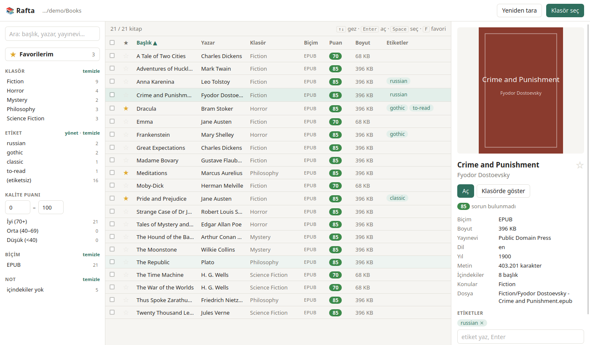

# Rafta

**A lightweight desktop app to browse, tag, filter and quality-check a local e-book folder.**
Point it at a folder of EPUBs and PDFs and get covers, metadata, a quality score for every file,
favorites and tags, all stored locally without touching your book files.



> *Rafta* is Turkish for "on the shelf". The interface is currently in Turkish.

## Features

- **Metadata at a glance:** author, title, publisher, language, year, subjects, description, cover, page/character count
- **Quality score (0–100):** spots scanned PDFs without a text layer, OCR'd scans, EPUBs made of page images,
  missing table of contents, very short texts and broken character encodings
- **Favorites:** star a book (★ or <kbd>F</kbd>), then list them with one click
- **Tags:** tag books one by one or in bulk; rename, merge or delete tags across the whole library
- **Fast filtering:** full-text search plus folder, tag, format, score range and quality-note facets, all combinable
- **Open anywhere:** open a book in your system's default reader or reveal it in the file manager
- **Remembers your library:** reopens the last folder and rescans only files that changed
- **No dependencies:** a single Python file using only the standard library, with a native window (no browser tab)

## Requirements

- Python 3.9+
- **Linux:** GTK 3 and WebKit2GTK 4.1 with Python bindings (preinstalled on Ubuntu/GNOME;
  otherwise `sudo apt install python3-gi gir1.2-webkit2-4.1`)
- **macOS:** [`pywebview`](https://pywebview.flowrl.com/) (`pip3 install pywebview`)
- *Optional:* `pdfinfo` / `pdftotext` from poppler for PDF analysis
  (`sudo apt install poppler-utils` or `brew install poppler`)

## Install & run

```bash
git clone https://github.com/cafercan/rafta.git
cd rafta
```

**Linux:** add Rafta to your application menu:

```bash
./install-linux.sh              # install or update
./install-linux.sh --uninstall  # remove (your tags and favorites are kept)
```

Or run it without installing: `python3 rafta.py`

**macOS:** double-click `Rafta.command` (it installs `pywebview` on first run), or run `python3 rafta.py`.

Options: `--browser` opens the UI in your web browser instead of a window, `--headless` runs the server only.
Set `RAFTA_PORT` to change the local port (default `8765`).

## Quality score

| Score | Typical file |
|---|---|
| 85–95 | Text-based EPUB with table of contents and cover |
| 70–80 | Text-based EPUB without a table of contents |
| 65 | Born-digital PDF with a text layer |
| 40 | OCR'd scan, DOC/TXT and other raw formats |
| 0–30 | Scanned PDF without a text layer, EPUB made of page images, unreadable file |

Broken Turkish characters (mojibake), very short texts and PDFs under 20 pages lower the score.
The score is a heuristic: it checks structure, not scan sharpness.

## Keyboard

<kbd>↑</kbd> <kbd>↓</kbd> navigate · <kbd>Enter</kbd> open · <kbd>Space</kbd> select · <kbd>F</kbd> favorite · <kbd>/</kbd> search

## Privacy & data

Everything runs on your machine. Settings, the metadata cache, tags and favorites live in
`~/.config/rafta/` (`config.json`, `rafta.db`). Rafta never modifies, moves or uploads your books.
Tags and favorites are linked to each file's path inside the library folder, so renaming or moving a
file outside Rafta drops its tags.

The UI talks to a local server bound to `127.0.0.1`. Every request must carry a random per-launch token
and a matching `Host` header, so other websites open in your browser can't use it.

## How it works

`rafta.py` starts a small HTTP server on localhost, scans the library in parallel (EPUB metadata from the
OPF file, PDF data through poppler) and caches the results in SQLite. The interface in `static/index.html`
is plain HTML/JS shown in a native WebKit window: GTK on Linux, pywebview on macOS.

## Türkçe

**Rafta**, bilgisayarındaki e-kitap klasörünü gezmek, etiketlemek, filtrelemek ve dosyaların kalitesini
görmek için hafif bir masaüstü uygulamasıdır. Kitap dosyalarına dokunmaz; etiketler ve favoriler
`~/.config/rafta/` altında saklanır.

- Linux'ta kurmak için: `./install-linux.sh` (uygulama menüsünde "Rafta" olarak görünür)
- macOS'ta: `Rafta.command` dosyasına çift tıklayın
- Kurmadan çalıştırmak için: `python3 rafta.py`

## License

[MIT](LICENSE)
